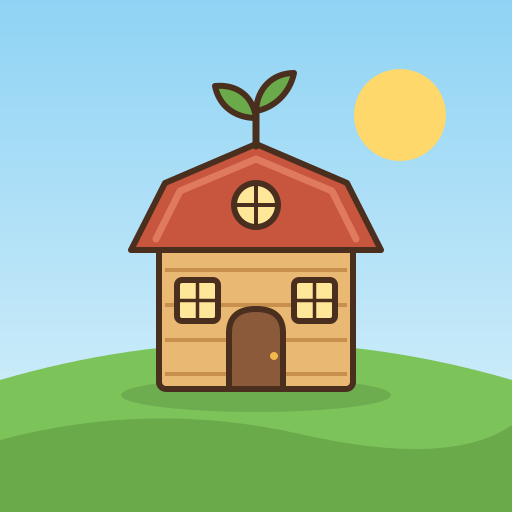
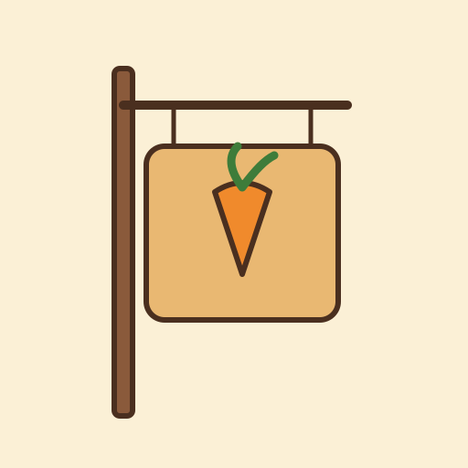

# Branding

Everything in `branding/` is generated by `python3 tools/build_branding.py`
(vector source → PNG with librsvg; lettering is converted to vector paths with
fontTools, so no installed fonts are needed).

## Three concepts

| | Concept | Idea |
|---|---|---|
| A |  **Barn-roof Inn** | A small wooden inn under a red gambrel (barn) roof, with a sprout growing from the peak, on a sunny hill. |
| B |  **Carrot Sign** | A hanging wooden inn sign with a carrot emblem. |
| C |  **Hearth Bowl** | A steaming bowl with wheat, the farm-to-table moment. |

## Choice: Concept A

- **It says both halves of the name.** Barn roof + sprout = *Harvest*; a lit
  doorway and windows = *Inn*. B reads as "a shop" and C as "a restaurant
  app"; neither says "farm game" at a glance.
- **Silhouette survives at 29–48 px.** The red roof is a single large shape
  that contrasts strongly with the blue sky, and there is no text inside the icon.
- **Character-friendly.** The inn is where the game takes place, so the icon
  is the same building the player sees in the game.

### Refinement (master `branding/logo.svg`)
- Added wheat stalks on both sides to frame the mark and strengthen the
  "harvest" reading. They sit low so they don't clutter the silhouette.
- Thick, warm-brown outlines (`ink`) instead of black for a cozy, friendly look.
- Removed a soft glow behind the inn that muddied the hills at small sizes.
- The adaptive Android foreground scales the inn into the 66% safe zone, so
  circle and squircle masks never clip the sprout.

## Deliverables
| File | Use |
|---|---|
| `branding/logo.svg` | Master vector logo (opaque, square) |
| `branding/wordmark.svg/.png` | Logo + "HarvestInn" lettering |
| `branding/ios/AppIcon.appiconset/` | All iOS icon sizes + `Contents.json`, **no alpha** (1024 marketing icon included) |
| `branding/android/adaptive/` | Adaptive foreground/background layers (432 px + SVG) |
| `branding/android/legacy/mipmap-*/` | Legacy launcher icons 48–192 px |
| `branding/android/playstore_512.png` | Play Store hi-res icon |
| `branding/splash/` | Portrait + landscape splash |
| `branding/store/feature_graphic_1024x500.png` | Play Store feature graphic |

## Palette (`branding/palette.json`)
| Token | Hex | Use |
|---|---|---|
| barn_red | `#C8553D` | Primary buttons, title |
| meadow | `#6BAA4B` | Success, "Inn", confirm |
| wheat | `#F2B84B` | Coins, highlights |
| cream | `#FBF0D6` | Panels, backgrounds |
| wood / wood_dark | `#E9B872` / `#8A5A3B` | Panel frames, tabs |
| sky / sky_light | `#8FD3F4` / `#DDF3FB` | Gems, info, backgrounds |
| ink | `#4A2F1F` | Text, outlines (never pure black) |

Text on cream uses `ink` (contrast ≈ 12:1). White text only sits on
barn_red or meadow at bold weights, 18 px or larger.

## Fonts (SIL Open Font License 1.1, bundled in `assets/fonts/`)
- **Fredoka** (SemiBold) for titles, numbers and buttons. It is rounded and friendly.
- **Nunito** for body text and dialogue. It is very readable at small sizes.
